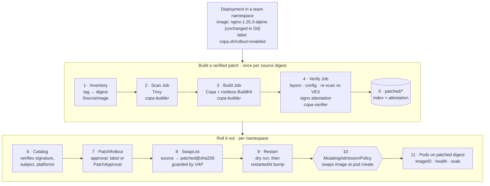
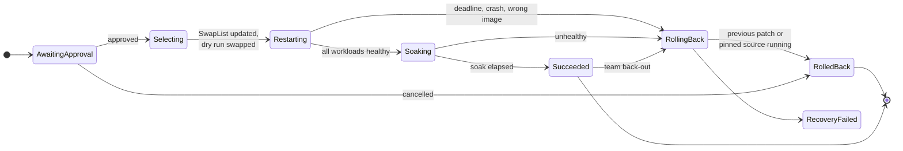

# copacabana

Prototype of in-cluster Copa OS patching: find the images opted-in workloads run, scan and patch them with
[Copa](https://github.com/project-copacetic/copacetic) in isolated Jobs, verify and sign the result, and roll
approved patches out through a MutatingAdmissionPolicy, without changing the image in Git.

Design: [docs/design.md](docs/design.md). Implementation sketch: [docs/implementation.md](docs/implementation.md).
Diagram: [docs/how-it-works.html](docs/how-it-works.html) (uses host theme variables, so it renders plainly on its own).

**Status: prototype.** It runs end to end on kind. It isn't hardened, and the limits below matter.

## How it works



A `PatchRollout` moves through these phases. A team can back out at any point, including after `Succeeded`, by
annotating a Deployment with `copa.sh/fail-rollout`.



| Resource | Scope | Written by | Purpose |
| --- | --- | --- | --- |
| `SourceImage` | cluster | controller | One source digest in use: users, current verified patch, gaps |
| `PatchBuild` | `copa-builder` | controller | One scan/build/verify attempt and its Jobs |
| `SwapList` (`copa`) | team namespace | controller only (enforced by a ValidatingAdmissionPolicy) | `spec.images` is what admission reads |
| `PatchRollout` | team namespace | controller | State machine for one candidate in one namespace |
| `PatchApproval` | team namespace | approvers | Approves one rollout's exact candidate digest |

Controller modes: `report-only` (inventory and scans), `builder` (everything), `consumer` (no Jobs; uses patches
found in `patched/*`).

## Layout

```
api/v1alpha1/          CRD types
cmd/controller/        copa-rollout-controller
cmd/worker/            copa-worker: scan | build | verify | keygen
internal/controller/   inventory, sourceimage, patchbuild (+ jobs), rollout, missedswap, catalog, metrics
internal/worker/       scan, build and verify steps
internal/attest/       in-toto statement, DSSE ed25519 sign/verify
internal/registry/     go-containerregistry helpers: resolve, tags, artifacts with subjects, referrers
internal/imageref/     normalization, aliases, floating-tag detection
config/                CRDs, RBAC, admission policies, builder namespace, in-cluster registry, controller
hack/                  kind-up.sh, deploy.sh, demo.sh, uninstall.sh, kubectl-copa plugin; edge/ scenarios;
                       forge/ forged patches
```

## Run it

Needs Docker, kind, kubectl, crane and Go. `COPA_SRC` must point at a Copa checkout (default
`~/go/src/github.com/project-copacetic/copacetic`); the worker image is built from it.

```sh
make kind      # kind cluster (Kubernetes 1.37) + local registry kind-registry:5000 / localhost:5001
make deploy    # build and push images, generate keys, install everything (in-cluster registry, builder mode)
make demo      # demo-dev (automatic approval) and demo-prod (manual approval) running nginx:1.25.3-alpine

kubectl get sourceimages
kubectl get patchbuilds -n copa-builder
kubectl get patchrollouts -A
PATH=$PWD/hack:$PATH kubectl copa approve -n demo-prod --all
kubectl -n demo-dev annotate deploy web copa.sh/fail-rollout=true     # team back-out
kubectl annotate sourceimage <name> copa.sh/rebuild=now               # rescan now
kubectl annotate sourceimage <name> copa.sh/rebuild=force             # new revision even without new fixes
KCTX=kind-copa RESTART=true hack/uninstall.sh                         # remove copa, moving workloads back to sources
```

Demo timings are short (`--healthy-for=30s --soak=2m`); see `config/manager/controller.yaml`.

`hack/deploy.sh` options (environment variables):

| Variable | Default | Effect |
| --- | --- | --- |
| `REGISTRY` | `in-cluster` | `in-cluster`: staging and patched images in a Zot registry inside the cluster, over TLS, with separate push accounts for builders and the verifier. `external`: the host's `kind-registry` (no auth, plain HTTP) |
| `REGISTRY_REMOTE` | | `ip:port` of another cluster's registry NodePort, for consumer clusters |
| `MODE` | `builder` | `builder`, `consumer` or `report-only` |
| `PLATFORMS` | `linux/amd64` | Platforms every patch must cover |
| `ALLOW_EMULATION` | `false` | Build platforms without matching nodes under qemu |
| `REPLICAS` | `2` | Controller replicas (leader election) |
| `SOURCE_AUTH` | | Docker config with logins for private source registries or Docker Hub |
| `EXTRA_INSECURE` | | More plain-HTTP source registries |
| `NOTATION` | `false` | Also sign patched images with Notation (test certificate) for an image integrity policy; see `hack/edge/kyverno-policy.sh` |

## What was exercised on kind

- MutatingAdmissionPolicy swaps containers and init containers by name, annotates the pod, leaves
  unlabelled pods and non-matching containers alone, and allows pods when the namespace has no SwapList.
- The SwapList guard rejects writes from anyone but the controller and `copa:platform-admins`, and rejects
  targets outside `patched/*` that aren't digest-pinned or the recorded fallback.
- Scan, build (rootless BuildKit in a pod on the tainted builder node), verify and promotion of
  `nginx:1.25.3-alpine` (74 fixable OS CVEs) in about 25 seconds.
- Copa kept all 8 source layers and appended 2; the only config change was the `BaseImage` label.
- Automatic approval in `demo-dev`, `PatchApproval` in `demo-prod`, bounded restarts, runtime `imageID` check,
  soak, `Succeeded`.
- Team back-out after success: the first patch rolled back to the pinned source digest, pods replaced and
  re-checked, `demo-prod` unaffected, and the rolled-back candidate not proposed again.
- A rescan of a current patch with no new fixes ends `NothingToFix` instead of building a new revision.
- A floating tag (`1.25-alpine`) on the same digest is listed but never swapped.

### Edge cases

Scripts in `hack/edge/` (start with `setup.sh`) and the forged-patch tool in `hack/forge/` reproduce these.

| Case | Result |
| --- | --- |
| Signing key rotated; old `-1` still in `patched/*` | Ignored ("no valid attestation from the trusted key"); `-2` built and rolled out |
| Forged revisions: replayed genuine attestation on a new index, attacker-signed index | Ignored; `UnverifiedPatch` warning event when they're newer than the trusted revision; no rollout |
| Genuine index re-tagged as a newer revision | Same digest, so no new rollout |
| Patch breaks readiness | Deadline exceeded, restored to the pinned source, `RolledBack` |
| PatchApproval for the wrong digest | Ignored, stays `AwaitingApproval` |
| Deployments created while awaiting approval, or after the rollout started | Tracked and restarted |
| Team deploys mid-restart / removes opt-in label / deletes the Deployment | `Superseded` / `OptedOut` (source image) / `Superseded`; rollout still succeeds |
| Controller killed mid-restart | Resumes and finishes |
| Recreate strategy, no readiness probe | `Ineligible`, not restarted; new pods still swapped at admission |
| Init container pinning the source by digest | Separate rollout for the digest reference; init container swapped |
| Back-out requested from a Deployment the rollout never tracked | Honored; that Deployment's admitted pods are restarted onto the restored image |
| Back-out of a tag while a digest reference of the same source keeps its patch | Tag users get the pinned source; digest users keep the patch |
| Tag moved to a new digest | New SourceImage, build and rollout; old SourceImage `Unused`; pods created in between get the last verified patch of the old digest |
| Image with no OS packages (`pause`) | `Gap`: "no OS packages detected" |
| Source without the cluster's platform (arm64-only) | `Gap` |
| Admission skipped (binding removed) | `MissedSwap` warning event and `copa_missed_swaps_total` |
| SwapList writes: stray key, alias pointed at another patched digest, `..` in path, fallback not pinned | Denied by the guard policy |
| Consumer mode | Rolls out existing verified patches; unpatched sources stay `Unpatched` with no PatchBuild |

Bugs this run found and fixed: SourceImages for sources without the cluster's platform failed validation and
stopped the inventory pass; rollouts only tracked Deployments present at creation; recovery and team back-out
ignored untracked Deployments; admission reinvocation chained swaps (tag -> pinned source -> another entry's
patch), defeating recovery; a scan with no OS reported "no fixable vulnerabilities"; forged newer revisions were
ignored silently; the guard only checked a prefix.

A later round covered the in-cluster registry, Docker Hub names, private registries, Argo CD, isolation,
multi-revision lifecycles, failure injection, other workload kinds, Copa distros, multi-platform builds, scale,
Notation with Kyverno, leader election, uninstall and a consumer cluster. Results and the bugs it found are in
[docs/validation.md](docs/validation.md).

Unit tests: `make test`.

## Prototype limits

- **Signing:** the controller trusts an ed25519 DSSE attestation (key in a Secret). With `NOTATION=true` the
  verify Job also signs with Notation using a test certificate, which Kyverno can enforce. Not Notation with a
  real CA or Key Vault.
- **Registry:** the in-cluster Zot runs one replica on a ReadWriteOnce volume, with a generated CA. Once patches
  roll out it's a runtime dependency for new pods. Old revisions aren't garbage-collected. No workload identity or
  ACR token exchange; accounts are htpasswd.
- **RBAC:** cluster-wide for Deployments and pods (pod `create` is needed for the dry run), narrowed by two
  ValidatingAdmissionPolicies to opted-in namespaces, dry-run pods and pod-template annotation changes. Not bound
  per namespace.
- **Policy:** configured with controller flags. There is no `PatchPolicy` resource yet.
- **NetworkPolicy:** job pods can reach the internet but not team pods or nodes. Under kindnet the API server
  stays reachable; job pods carry no token.
- **Rollouts are per reference, not per digest:** a tag and a digest reference to the same source roll out and
  back out separately. A pod that already carries a `copa.sh/swapped` annotation isn't swapped again (that's what
  stops chained swaps); the missed-swap detector flags it.
- **Rollout scope:** only Deployments are restarted. StatefulSets and DaemonSets are listed as not restarted and
  get the patch when their pods are recreated. Ineligible Deployments aren't restarted either.
- **Not exercised:** 24-hour soaks, real arm64 nodes, Flux, CRD version conversion, envtest.
- **Patched repo naming** includes the source registry host (`patched/kind-registry-5000/library/nginx`) so
  sources from different registries can't collide.
