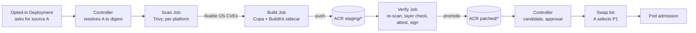
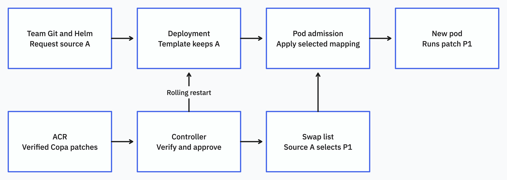
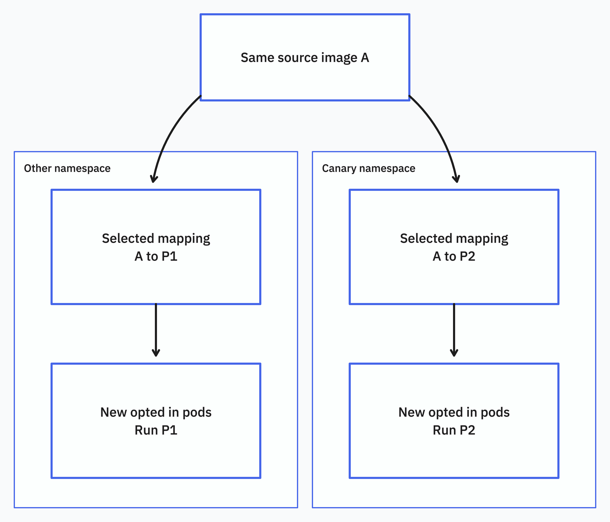
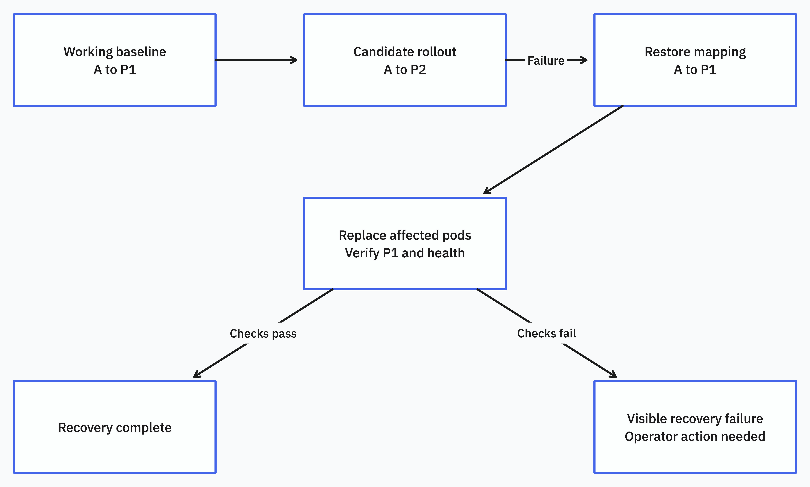

In-cluster Copa OS patching

Nov 3, 2026 · @Sertac · Draft, revised from "In-cluster Copa OS patch rollout" (Oct 5, 2026)

# Problem
Copa can publish a patched image long before that image runs in production. Today a patch takes four steps to reach running pods:

1. A pipeline runs Copa and pushes the patched image to Azure Container Registry (ACR).
2. Dependabot finds the new image and opens a PR against the team's deployment config.
3. The team reviews and merges the PR.
4. The team deploys, which replaces the running pods.

Each step waits on something different. The pipeline runs on a schedule, Dependabot checks on its own schedule, the team reviews when it has time, and the deploy follows the release process. Even a merged PR doesn't mean the app is running the patch.

The pipeline adds a gap of its own. It only patches images someone listed in its config, and it doesn't know what is running. Images that a cluster runs but the pipeline doesn't know about never get patched, and the pipeline keeps patching images nothing runs anymore.

# Goals
Patch what clusters actually run. The cluster finds the source images its opted-in workloads use, then scans and patches them, without a central list someone has to maintain.

Get Copa OS patches running in pods soon after a fix is available, without a PR or a team-triggered deploy for each patch.

Keep approval, verification and rollback. Teams and the platform agree a patching policy up front, production can require approval for each patch, and a failed patch goes back to the last good image.

Keep untrusted build work away from workloads and credentials. Patching runs package-manager scripts from the source image and the distro's repositories. That work must not share nodes, identities or secrets with production.

Leave teams in charge of what they run. Teams keep choosing the app and version in Git, and keep referencing images the way they do today, usually by tag.

Make every swap visible, so anyone can tell which patch a pod runs and how it was built.

Let teams back a patch out on their own during an incident.

# Non-goals
These are out of scope for the first release:

Moving workloads to a new upstream version, such as `nginx:1.25.3` to `nginx:1.25.4`. Teams still upgrade versions in Git.

Language and library patches. The first release applies OS package patches only.

Workloads other than Deployments installed with Helm. See "Other workload types".

Private source images from registries the builder can't read with its own identity. See "Pulling sources and patched images".

Running builders in production clusters. See "Where builds run".

Updating Git to show the patched image. Git keeps the team's original image, and admission records the swap on each pod.

# Recommendation
Move the whole loop into Kubernetes. A controller finds the source images opted-in Deployments use. Short-lived Jobs scan each source and patch it with Copa in an isolated builder node pool. A separate verify step re-scans the result, checks it was built correctly from the source, signs it, and promotes it to the repository that clusters run from. The controller then rolls out approved patches the way the earlier design described: admission swaps the image when a pod is created, and the controller restarts workloads, watches health and rolls back failures.

Figure 1. The build path. Each step runs as its own Job with its own identity. Only the verify Job can sign, and only signed images in `patched/*` can be selected.

Figure 2. The rollout path. Git keeps source A. The controller selects P1, and admission applies it to new pods.

Start small, in two steps. First, report only: list the source images in use, which ones have fixable OS vulnerabilities, and whether Copa can patch them. Then build and roll out in opted-in non-production namespaces. Production consumes patches that were built and soaked in non-production. It doesn't build its own.

This still needs an ownership agreement. Teams pick the app version and source image in Git. The platform picks which approved patched build of that source image runs. So a Deployment can ask for the team's source image while its pods run a patched copy, and admission records the swap on every pod it changes.

If the platform doesn't get that authority, the build half of this design still works on its own. The cluster builds and promotes patches, and auto-merged PRs carry the patched digests into Git. That keeps Git accurate. The report-only phase measures whether that path is fast enough before we commit to admission.

# Components

| **Component** | **Runs where** | **Can do** | **Can't do** |
| --- | --- | --- | --- |
| Controller | Platform namespace, system node pool | Read opted-in pod templates, create scan, build and verify Jobs, write swap lists, restart opted-in Deployments | Push or sign images |
| Scan Job | Builder namespace and node pool | Pull the source, write a Trivy report | Push, sign, or reach workloads |
| Build Job | Builder namespace and node pool | Pull the source, run Copa with a BuildKit sidecar, push to `staging/*` | Push to `patched/*`, sign |
| Verify Job | Verifier namespace and node pool | Read `staging/*`, re-scan, sign, copy to `patched/*` | Run code from the image under test |
| Admission policy | API server | Swap images on pod create using the namespace's swap list | Anything else |
| Swap list | One custom resource per opted-in namespace | Record selected, candidate and previous patches | |

The controller is a separate project that uses Copa. It doesn't belong in the Copa repository, because most of it is cluster policy.

# How a patch is built
1. The controller reads the pod templates of opted-in Deployments and collects the image strings they ask for. It resolves each one to a digest. For a multi-platform index, it also records the digest for each platform its nodes run.

2. For each source digest and platform, it looks in `patched/*` for a signed, attested patch built from that source. If one exists, it schedules a scan of that patched image instead of the source. If the patch has no fixable OS vulnerabilities left, nothing more happens.

3. Otherwise it creates a scan Job for the source. The Job runs Trivy against the platform digest and writes an OS-only report:

   `trivy image --pkg-types os --format json -o reports/linux-amd64.json "docker.io/library/nginx@${PLATFORM_DIGEST}"`

4. If the report has fixes Copa can apply, it creates a build Job. The Job always starts from the original source, never from an earlier patch, so layers don't pile up across revisions. It runs on a node of the target platform and patches the platform digest:

   `copa patch -i "docker.io/library/nginx@${PLATFORM_DIGEST}" -r reports/linux-amd64.json -t myacr.azurecr.io/staging/nginx:1.25.3-2-linux-amd64 -a unix:///run/buildkit/buildkitd.sock --push -f openvex -o vex.json`

5. A verify Job checks each staged image, then assembles and promotes the result. See "Verifying and promoting a patch".

6. The controller sees the new signed patch in `patched/*` and stages it as a candidate. From here it follows "How a patch reaches running pods".

The controller saves its progress in custom resources, so it can resume after its own restart without starting duplicate builds. It keys every build by source platform digest. Two workloads in different namespaces that use the same source share one build.

## When to build
The controller rescans each source digest in use:

- when an opted-in template first asks for it
- after each Trivy database update, at most once per agreed interval, for example daily
- on demand, when a platform operator asks for a rebuild after a critical advisory

It builds a new revision only when the latest scan finds OS fixes the current patch doesn't have. A new revision doesn't mean the old one was wrong, so rollouts of new revisions go through the same candidate, approval and soak steps as the first one.

Builds aren't reproducible. Distro repositories move, so building the same source twice a day apart can install different package versions. The patched digest is the identity, and the attestation records exactly which package versions went in.

## Platforms
A multi-platform index points to one image per platform. Copa can patch every platform in one run, but it needs QEMU emulation for platforms other than the host's, which means a privileged binfmt setup on the builder nodes. It also copies platforms without a report into the result unpatched.

Instead, run one build Job per platform, each on a node of that platform, and have the verify Job assemble the index. Only patched platforms go into the index. If the builder can't patch a platform the cluster's nodes run, the patch doesn't become a candidate. A node on that platform could otherwise pull an unpatched image, or fail to pull at all.

This also sidesteps a Copa bug: in a multi-platform run, every platform's VEX document goes to the same `-o` path, so the file ends up describing one platform (issue #1732). With one Job per platform, each Job writes its own VEX.

If the builder node pool only has one architecture, limit the pilot to sources and clusters on that architecture. Turn on emulation later only if native nodes for the other platforms aren't available, and review the privileged binfmt DaemonSet separately.

# Isolating the builder
The build Job runs code we don't control. Copa runs the distro's package manager inside the source image, and that runs maintainer scripts from both the image and the distro's repositories. Treat the builder like a CI runner for untrusted code.

| **Piece** | **Setup** |
| --- | --- |
| Namespace and nodes | Dedicated builder namespace and node pool, tainted so nothing else schedules there. No production workloads, no unrelated secrets |
| BuildKit | One sidecar per Job, reached over a Unix socket, rootless if possible. No shared BuildKit daemon on the network. No cache shared between Jobs |
| Identity | Workload identity that can pull sources and push only to `staging/*`. The token is mounted only into the Copa container, not the BuildKit sidecar. Package scripts run inside BuildKit's sandbox, which doesn't receive the token |
| Network | Egress only to source registries or their ACR cache, distro package mirrors, the Trivy database mirror, and identity endpoints |
| Limits | Cap concurrent Jobs per node pool and set a timeout on each. Delete finished Jobs and their volumes |
| Pod Security | Rootless BuildKit can still need relaxed seccomp and AppArmor profiles. Confirm the mode and AKS settings before choosing a Pod Security level |
| Sandboxing | Dedicated nodes, taints and network policy reduce exposure but don't give VM-level isolation. Use Pod Sandboxing for the builder pool where it's available |

A compromised build Job can only write to `staging/*`. Nothing selects images from staging. The verify Job decides what reaches `patched/*`.

# Verifying and promoting a patch
The verify Job runs in its own namespace and node pool, with its own identity. It never runs the image under test. It reads manifests and layers, and it scans. For each staged platform image, it checks:

- The patched image's layers start with the source image's layers, unchanged, and Copa only appended layers on top. Confirm this holds for every package manager in scope before relying on it.
- The image config matches the source except for the fields Copa is expected to change, such as labels and the history.
- A post-patch Trivy scan with the same database finds none of the OS vulnerabilities the build was meant to fix, and no new ones. An image that fails this scan never becomes a candidate.

If every platform passes, it assembles an index from the patched platform images and writes a signed attestation for it. The attestation records:

- the source index digest and the source digest for each platform
- the patched index digest and the patched digest for each platform
- which platforms were patched. Every platform in the index was patched, because unpatched platforms aren't included
- the digests of the scan reports, the Trivy database version, and the VEX documents
- the package versions installed, and the Copa and BuildKit versions used

It signs the index and the attestation, for example with Notation and a Key Vault key, then copies the index to `patched/<repo>:<tag>-<revision>`, such as `patched/nginx:1.25.3-2`. Only the verify identity can sign or write `patched/*`.

The controller only accepts candidates from `patched/*` with a valid signature and attestation from the verify identity. Admission validation enforces the same rule, so a mistake in the controller can't select an unsigned image.

Copa doesn't produce any of this today. It writes an unsigned `BaseImage` label set to whatever reference was passed to `-i`, and it doesn't copy the source's signatures or attestations. The verify Job builds the attestation from what it observed, not from what the build Job claims. See "Changes to Copa that would help".

# Where builds run
Builders run in a non-production cluster, on the dedicated node pool above. That cluster builds patches for the source images its own opted-in workloads use.

Production clusters run the controller and admission, but no builders. Their controllers look for signed patches in `patched/*` and roll them out. Production then only runs patches that were already built and soaked in non-production, and it never hosts untrusted build work or push identities.

If a production cluster runs a source image that no non-production cluster runs, the controller reports it as a gap. The first release doesn't build for it. Later, production controllers could publish their source inventory for the builder cluster to pick up.

# Tags and digests
Teams reference images the way they do today, usually by tag, such as `nginx:1.25.3`. Digest references work too.

Every patch belongs to the exact source content it patched. The controller resolves each tag to a digest before scanning, and the build always uses the digest. The swap-list entry maps the image string as the template writes it to the patched digest, and records the source digest it was built from. Admission then only needs a string match.

The controller writes the image string exactly as the template has it, and admission compares after normalizing both sides. `nginx:1.25.3`, `docker.io/nginx:1.25.3` and `docker.io/library/nginx:1.25.3` are the same image.

Floating tags such as `latest`, `1` or `1.25` aren't eligible in the first release. A team using one of them expects new upstream content, and a swap would pin them to an old source digest. The controller reports those workloads as not eligible.

Upstream can also rebuild a fixed-looking tag such as `1.25.3` under the same name. The controller notices the new digest the next time it resolves the tag. It reports the drift, scans and builds from the new digest, and rolls out the result as a new candidate. Until then, pods keep their current patch.

Approvals, verification and rollback all use digests. Readable tags such as `1.25.3-2` help people scan image lists, but moving one of those tags never changes what a rollback restores.

# How admission swaps the image
Admission runs when the Kubernetes API server receives a request to create a pod, before the pod starts. A mutating policy can change the pod's image at that point. Validation policies then check the result.

On Kubernetes 1.36 and later, use MutatingAdmissionPolicy, which runs inside the API server and reads the swap list from the pod's namespace as a parameter. On older clusters, use Gatekeeper with external data if it can enforce group boundaries. Write a custom webhook only if neither works.

Admission only changes new pods. Running pods keep their image until the controller replaces them with a rolling restart. Admission applies to every matching new pod, including pods created by autoscaling or after a node failure, so you can't limit a test patch to a few pods by choosing which Deployments to restart first.

# Rollout groups
A rollout group is the set of workloads one approval covers. Each group has a soak period, the time patched workloads must run healthy before the patch can go to a wider group.

At first, each group is one namespace. The namespace opts in, and each participating Deployment's pod template carries the label `copa.sh/rollout: enabled`. Admission only swaps images for pods that match both. For a smaller test group, use a separate namespace. Two mappings for the same source must never match the same pod.

Figure 3. Approval changes the selected patch for one namespace. Scaled and replacement pods in that namespace follow the same mapping.

# How a patch reaches running pods
1. The controller stages a signed patch from `patched/*` as a candidate for a rollout group. It records the current patch, the previous approved patch and the health checks it will use. A newer patch waits until the current rollout finishes.

2. It checks that each Deployment meets the restart and recovery requirements. Depending on the group's policy, the candidate is approved automatically or waits for an approver. Approval covers the exact source digest, patched digest, group and health policy.

3. It selects the candidate in the swap list, then sends a server-side dry-run pod create to confirm that admission picks up the new mapping.

4. It sets `kubectl.kubernetes.io/restartedAt` on each eligible Deployment's pod template, which is what `kubectl rollout restart` does. It restarts at most an agreed number of Deployments at a time per cluster and per node pool, and only inside the group's maintenance window if it has one.

5. It checks the new pods and watches health until the rollout deadline and soak period pass. If they pass, this patch becomes the new known-good baseline. If not, the controller restores the previous patch and starts recovery.

If a team changes a workload's source image or template during a rollout, the controller re-checks that workload. It must never restart or revert the team's new version to finish an outdated rollout.

Each controller restart adds a ReplicaSet revision, which counts toward the Deployment's `revisionHistoryLimit`. With frequent patches, a limit of 10 pushes the team's own revisions out of history quickly. Recommend a higher limit for opted-in workloads.

# The swap list
The swap list records which patched image admission should use for each source image in a namespace. It's a custom resource, one per opted-in namespace.

| **What it stores** | **Why** |
| --- | --- |
| Source image as the template writes it, and its resolved digest | Admission matches the string. The digest records which content the patch was built from |
| Rollout group and opt-in labels | Which pods get the patch |
| Candidate digest and its attestation | The proposed patch and proof of how it was built |
| Selected image reference and digest | What admission applies right now |
| Previous approved image reference and digest | Where recovery goes back to |
| Approval and health policy | Who or what approved the change, and how success is judged |
| Rollout state and workload status | Lets the controller resume, recover, or notice a newer team deploy |

Keep mappings after a rollout succeeds. The Deployment template still asks for the source image, so deleting the mapping would send the next redeploy back to the unpatched image. Remove a mapping only when no opted-in template or pending recovery needs it, and only after a grace period. Keep mappings for Deployments scaled to zero.

Only the controller and named platform admins may write the swap list. Anyone who can edit it decides what code runs in its namespace. Don't add the labels that fold it into the built-in `admin` and `edit` roles.

# Checking the rollout
Checking the image has two parts. First, check that each targeted container in the admitted pod spec, including init containers, has the intended patched image. Then check that the container runtime is running the right image for the node's platform. Kubernetes allows `status.containerStatuses[].imageID` to differ from the image in the pod spec, so record both digests and test the comparison on each AKS runtime we support.

The right image proves the patch reached the pod. Health checks tell you whether the app still works. For automatic Deployment rollouts, require:

- the `RollingUpdate` strategy with `maxUnavailable: 0` and a `maxSurge` above zero
- enough spare capacity for the extra pods, checked before the restart
- readiness probes that show whether serving containers can handle traffic

Agree a rollout deadline, how long new pods must stay healthy, and a soak period. Use app metrics where they exist. Without them, the controller can say Kubernetes considers the rollout healthy, but not that the app works.

A Deployment that passes its progress deadline reports failure but keeps going. The controller has to act to recover. An alert alone isn't enough.

# Making the swap visible
When admission swaps an image, it adds annotations to the pod with the requested source image, the patched digest and the swap-list version it used. Anyone looking at the pod, the audit log or an incident timeline can see both images, and can follow the patched digest to its attestation.

Tools that read images from Deployment specs, such as inventory reports and CVE dashboards, will keep showing the unpatched source image. Point them at running pods or at the controller's report, which lists each workload's source image, patched image, adoption status, and any build gaps. Otherwise dashboards will flag workloads as vulnerable after they've been patched.

# Rolling back
Rollback puts a known-good image back and checks that the workloads recover. Changing the swap list is only the first step.

Say patch P1 works and patch P2 fails. Point the mapping back at P1, replace the pods running P2, and check their images and health. For a first patch, the fallback is the recorded source digest. Admission applies that digest in place of the tag, so pods go back to exactly what ran before.

The controller marks a rollback complete only after the recovery checks pass. If they don't pass, it raises a visible recovery failure for an operator. If recovery pauses a Deployment, agree that with the GitOps owner first, and only undo pauses the controller made.

Don't retry a failed patch in the same group until someone has looked at it. A failure in one app doesn't mean every group should reject the patch. A failed image check or a failed post-patch scan affects everyone, so those reject the patch everywhere and mark the build for triage.

Figure 4. Recovery restores the previous approved mapping, replaces affected pods and checks health.

## When a team needs to back out
During an incident, `helm rollback` or `kubectl rollout undo` doesn't remove the patch. Both put source A back in the template, and admission swaps the selected patch in again. Teams need a way out that works:

To drop the patch right away, the team removes the `copa.sh/rollout` label from the pod template and deploys. Admission skips those pods. The controller treats this as an opt-out and reports the workload as unpatched.

To go back to the previous patch instead, the team asks the controller to fail the rollout for their group, at first through platform on-call and later through an annotation on the Deployment.

Document both in the team onboarding guide before the pilot starts.

# Admission and GitOps guardrails
Only swap images when a pod is created. Changing the image during an unrelated pod update could restart a running container in place.

Admission fails open with `failurePolicy: Ignore`. If the swap fails, the pod starts with the source image it asked for. Missed swaps must be visible and must not count as adoption. Never fall back to one shared default image.

On the MutatingAdmissionPolicy binding, set `parameterNotFoundAction: Allow`, so a namespace with no swap list yet counts as nothing to swap rather than as an admission failure.

Patched images must come from `patched/*` and carry a valid signature and attestation from the verify identity. Keep the existing signing and image validation rules. The only allowed fallback is the recorded source digest, for a first rollout.

Other admission webhooks can also change pod images. Kyverno may resolve tags to digests, and a registry mirror policy may rewrite hostnames. Test the swap alongside these on the target clusters, and set `reinvocationPolicy: IfNeeded`.

Agree on the restart annotation with whoever runs the deploy path, whether that's Helm, Argo CD or Flux, and check that their sync leaves it in place. Without that agreement, keep the workload report-only.

## Pulling sources and patched images
The builder pulls every source it patches. Pull Docker Hub and other public sources through an ACR artifact cache, so scans and builds don't hit upstream rate limits and the builder's egress stays narrow. Mirror the Trivy database too.

The builder can't use pull secrets from team namespaces. In the first release, it only patches public sources and ACR repositories its identity can read. Patched copies of private team images must be visible only to people who could see the source. Put them in per-team repositories with matching ACR access before patching private images.

Pods that asked for a docker.io image now pull from ACR. Every cluster in scope needs pull access to `patched/*`, for example by attaching the registry to the cluster.

## Gatekeeper
If Gatekeeper is used instead of MutatingAdmissionPolicy:

- Its documented three-minute response cache covers audit and validation, not mutation. Measure how long a rollback takes to reach mutation on the deployed version.
- The lookup request doesn't include the pod's namespace. Group-specific mutators and providers, or another tested design, must tell the same source image apart in different groups.
- Gatekeeper orders its own mutators, but that says nothing about order relative to other webhooks. Test it with registry rewrites.
- External data providers must use TLS 1.3.

# When a patch can't be built
Not every source can be patched. The controller reports these as gaps instead of retrying forever:

- end-of-life distributions, where no fixed packages exist
- package managers Copa doesn't support, and images with no package manager or package database
- fixes the distro hasn't shipped yet
- images whose post-patch scan or layer check fails

Retry mirror, network and signing failures with backoff, then send them to triage. An end-of-life distribution needs a base-image change by the team, and the report should say so.

# Other workload types
Start with Deployments, because rolling restart gives the controller a built-in way to replace pods. Each other workload type needs its own replacement and recovery rules.

| **Workload** | **Later approach** | **Open questions** |
| --- | --- | --- |
| DaemonSet | Rolling restart | Health per node, surge capacity, and conflicts over host ports or other exclusive resources |
| StatefulSet with RollingUpdate | Rolling restart | Update partitions, quorum, and recovering from an unhealthy pod |
| StatefulSet with OnDelete | Replace one pod at a time | App-specific health and recovery checks |
| Job or CronJob | Swap the image for future pods | Keeping mappings for schedules that rarely run, and what an approval covers |
| Bare pod | Leave alone at first | Any in-place change needs an agreed outage and recovery plan |
| GitOps that strips the restart annotation | Maybe evict pods through the eviction API | PodDisruptionBudgets can block eviction, and eviction can reduce capacity |

# Changes to Copa that would help
The design works with Copa as it is, but these changes would remove work from the controller and the verify Job:

1. **Patch attestation output.** Copa knows the source digest, the platforms it patched and preserved, the reports it used and the packages it installed. An opt-in in-toto attestation with those fields would be more trustworthy than one rebuilt from outside, and useful to every Copa user. The verify Job should still check it rather than trust it.
2. **Per-platform VEX in multi-platform runs** (issue #1732). Needed before the builder can use Copa's multi-platform mode instead of one Job per platform.
3. **OCI layout output for single-platform images.** `--oci-dir` only applies to multi-platform runs today. With it, the build Job could write a layout and hand it to the verify Job, and would need no push identity at all.

# Pilot and decisions needed
Start in report-only mode in one non-production cluster. The controller lists the source images in use, scans them, and reports which ones have fixable OS vulnerabilities and which Copa can patch. It doesn't build. Also measure how long each step of today's PR flow takes.

Then turn on builds, verification and promotion, still without rollout. Check that patches pass verification, how long builds take, and what fails.

Then turn on automatic rollout and recovery in opted-in non-production namespaces. Before production, show that:

- builds are isolated: the build identity can't write `patched/*`, and the builder pool can't reach anything outside its allowed egress
- mappings survive redeploys and scale-to-zero
- admission respects group boundaries
- a failed patch returns workloads to the recorded fallback
- teams can back a patch out on their own

Production starts with an approval for each group and a soak before the next group, and uses patches promoted from non-production. Moving to automatic approval needs an agreed health policy and evidence that recovery works.

Track how long it takes from a fix being available to the patch running in pods, how many swaps were missed, build failure rate by cause, and how long recovery took. Those numbers decide whether we go to production.

Open decisions:

1. Does the platform have authority to choose a patched image while Git still lists the team's original image? If not, do we keep the build half and use auto-merged PRs?
2. Which cluster hosts the builder pool, and is it acceptable that production only gets patches for images non-production also runs?
3. What identities and isolation can we get approved for the build and verify Jobs? Is Pod Sandboxing available on the builder pool?
4. Which signing key and identity does the verify Job use, and does the existing image integrity policy accept it?
5. Can teams keep the opt-in label and restart annotation in their manifests?
6. Do target AKS clusters support MutatingAdmissionPolicy, or can Gatekeeper enforce group boundaries?
7. Which platforms must the builder support natively, and is emulation acceptable for any of them?
8. How do clusters get pull access to `patched/*`, and when do we support private team sources?
9. Are namespaces an acceptable first approval boundary, and which workloads go in each group?
10. What rescan interval, rollout deadline, healthy duration, soak period, restart concurrency and failure thresholds should we use?
11. Who reviews and approves the controller's cluster permissions?

# References
[Kubernetes: Mutating Admission Policy](https://kubernetes.io/docs/reference/access-authn-authz/mutating-admission-policy/), for parameter resources and namespace selection.

[Kubernetes API: ParamRef](https://github.com/kubernetes/api/blob/master/admissionregistration/v1/types.go), for per-namespace parameters and `parameterNotFoundAction`.

[Kubernetes: Deployments](https://kubernetes.io/docs/concepts/workloads/controllers/deployment/), for surge, unavailability, progress deadlines and pausing.

[Kubernetes: StatefulSet forced rollback](https://kubernetes.io/docs/concepts/workloads/controllers/statefulset/#forced-rollback), for recovery that requires deleting failed pods.

[Kubernetes API: ContainerStatus](https://github.com/kubernetes/api/blob/master/core/v1/types.go) and [OCI image index](https://github.com/opencontainers/image-spec/blob/main/image-index.md), for runtime image IDs and multi-platform images.

[Gatekeeper: External Data](https://open-policy-agent.github.io/gatekeeper/website/docs/externaldata/), for provider inputs, failure policies, cache scope, mutation order and TLS.

[Copa multi-platform patching](https://project-copacetic.github.io/copacetic/website/multiplatform-patching), for how report files and directories select platforms, emulation, and why source attestations aren't copied.

[Copa BaseImage label](https://github.com/project-copacetic/copacetic/blob/main/pkg/buildkit/buildkit.go) and [multi-platform VEX output](https://github.com/project-copacetic/copacetic/blob/main/pkg/patch/multi.go), for what Copa records about the source today.

[Copa issue #1732](https://github.com/project-copacetic/copacetic/issues/1732), for VEX in multi-platform runs.

[BuildKit: Rootless mode](https://github.com/moby/buildkit/blob/master/docs/rootless.md), for builder security profiles.
